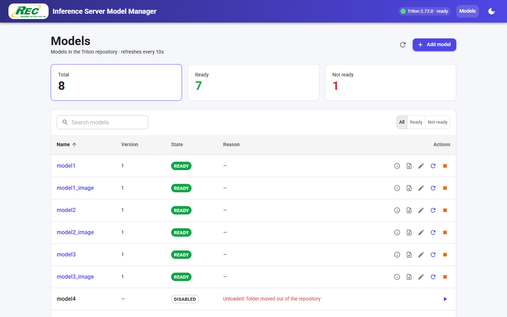
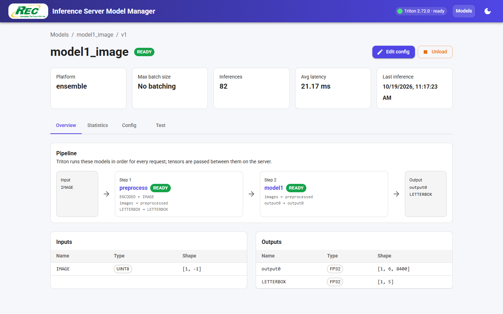
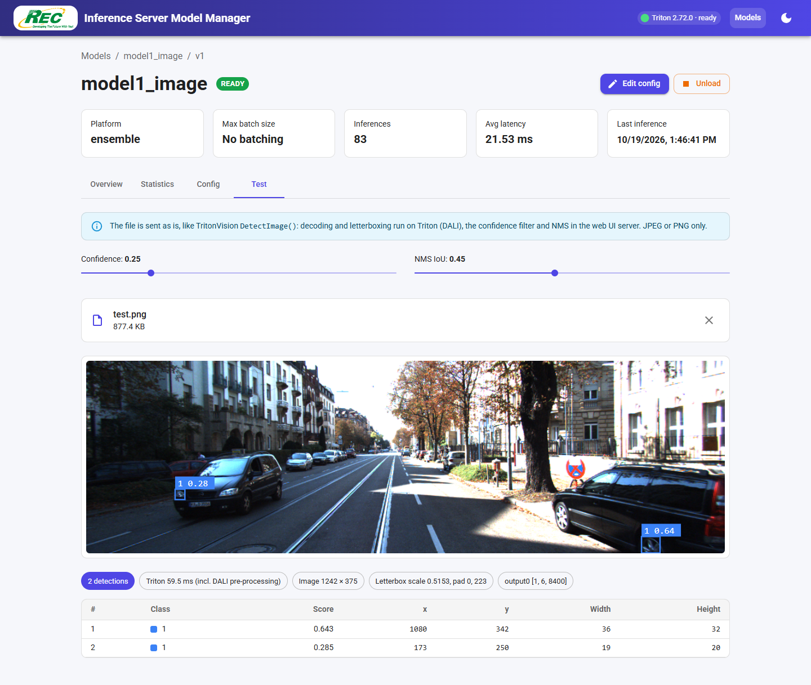
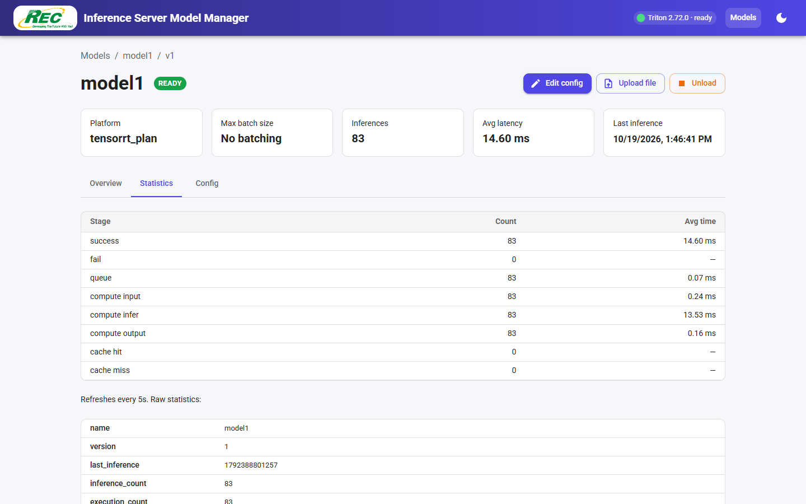
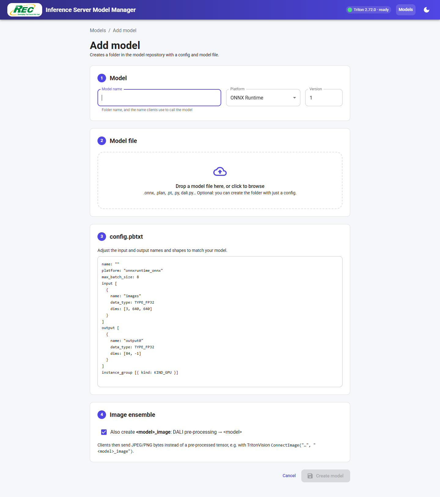

# Triton Vision Web Server

A web UI for managing and testing an NVIDIA Triton Inference Server, built for the
TritonVision pipeline (YOLO detection models with DALI pre-processing) running on a
Jetson.

It is a fork of [duydvu/triton-inference-server-web-ui](https://github.com/duydvu/triton-inference-server-web-ui).
On top of the original model list, config viewer and metrics, it can:

- manage the model repository on disk (add models, upload model files, edit `config.pbtxt`),
- load and unload models while Triton runs in **poll** mode,
- generate the `<model>_image` ensembles that TritonVision `ConnectImage()` / `DetectImage()` call,
- run a test image through an ensemble and draw the detections in the browser.

This project is not affiliated with NVIDIA.



## Quick start

### Use the lab Jetson

Triton and the web UI are already running, so all you need is a browser.

1. Open **http://140.129.7.180:3000**.
2. Click **Add model**, enter a name (e.g. `model5`), pick the platform and drop the `.onnx`, `.plan` or `.pt` file.
3. Keep **Also create `model5_image`** ticked and click **Create model**.
4. Wait about 5 seconds, until both models show **READY**.
5. Open `model5_image`, go to the **Test** tab and drop a JPEG or PNG to check the detections.
6. From code, call it with TritonVision: `ConnectImage("140.129.7.180:8001", "model5_image")`.

### Set up a new Jetson

Needs JetPack with Docker, the NVIDIA Container Toolkit and Node.js 20.9 or newer.

```bash
git clone https://github.com/CaptainAAI/TritonWebServer.git ~/triton-inference-server-web-ui && cd ~/triton-inference-server-web-ui && ./deploy/install.sh
```

The script asks for your sudo password, then:

1. creates `~/nvidiatriton/model_repository` and `~/nvidiatriton/disabled_models`, and adds the `preprocess` (DALI) model,
2. copies [`deploy/compose.yaml`](deploy/compose.yaml) to `~/nvidiatriton/` and starts Triton with it,
3. writes `.env.local`, installs the dependencies and builds the web UI,
4. installs and starts the `tritonserver` systemd service, so the web UI starts at boot,
5. prints the URL once Triton and the web UI answer.

It is safe to run again, e.g. after a `git pull`: existing models, `compose.yaml` and
`.env.local` are kept. Set `TRITON_DIR` to use another folder than `~/nvidiatriton`.

## Features

**Models page (`/repo`)**
- Every model Triton knows about, with its state, version and the reason it failed to load.
- Total / Ready / Not ready counters that double as filters, plus a search box.
- Refreshes on its own: Triton polls the repository, so new and changed models show up without reloading the page.
- Server status (name, version, ready) in the app bar, and a light/dark mode switch.

**Model page (`/models/<model>/versions/<version>`)**
- Summary cards: platform, max batch size, inference count, average latency, last inference.
- **Overview**: inputs and outputs, instance groups, the files in the version folder, and the pipeline. For an ensemble that is its steps in order; for any other model, the ensembles that call it.
- **Statistics**: count and average time per inference stage, plus Triton's raw statistics. Refreshes on its own.
- **Config**: the `config.pbtxt` on disk, or the config Triton loaded when the repository is not configured.
- **Test** (image ensembles only): drop a JPEG or PNG, adjust the confidence and NMS IoU thresholds, and see the boxes, the Triton time (DALI pre-processing included) and the letterbox values.

Overview of an image ensemble, with its pipeline:



Test tab, running an image through `model1_image`:



Statistics tab:



**Add model (`/repo/new`)**
- Templates for ONNX Runtime, TensorRT, PyTorch (TorchScript), Python, DALI and Ensemble.
- Uploads the model file with a progress bar. The file is staged next to the repository and renamed into place, so Triton never sees a half-written file.
- Optionally creates `<name>_image` as well: DALI pre-processing followed by the new model.
- For the Ensemble template, picking a loaded YOLO model fills in the inputs, outputs and steps.



**Per-model actions**
- **Upload / replace model file**: as a new version folder (the old version stays on disk for rollback) or overwriting a file in an existing version.
- **Edit config**: writes `config.pbtxt` on disk in poll mode, or sends the config with a load request in explicit mode.
- **Load / Reload / Unload**: see [Load and unload in poll mode](#load-and-unload-in-poll-mode). Unloading a model that loaded ensembles depend on asks whether to unload those ensembles too.

## Deployment on the Jetson

| Component | How it runs | Ports |
|---|---|---|
| Triton 26.08 (`nvcr.io/nvidia/tritonserver:26.08-py3`) | Docker container `triton`, from `~/nvidiatriton/compose.yaml` | HTTP 8000, gRPC 8001, metrics 8002 |
| This web UI | systemd service `tritonserver.service`, which runs `npm start` in this folder | 3000 |

Despite its name, `tritonserver.service` runs the **web UI**, not Triton.

The files for a new setup are in [`deploy/`](deploy/): `compose.yaml`, the `preprocess`
model, the systemd unit template and `install.sh` (see [Quick start](#set-up-a-new-jetson)).

Triton is started with `--model-control-mode=poll --repository-poll-secs=5`, so it picks
up changes in the model repository within about 5 seconds.

Folders on the host:

| Path | What it holds |
|---|---|
| `~/nvidiatriton/model_repository` | The model repository, mounted into the container as `/models` |
| `~/nvidiatriton/disabled_models` | Models unloaded from the web UI (moved out of the repository) |
| `~/nvidiatriton/.webui-uploads` | Temporary files while an upload is in progress |

Open the web UI at `http://<jetson-ip>:3000`.

### Common commands

Deploy a code change (or run `./deploy/install.sh`, which does the same):
```bash
cd ~/triton-inference-server-web-ui
npm ci
npm run build
sudo systemctl restart tritonserver
```

Web UI logs:
```bash
journalctl -u tritonserver -f
```

Triton (the `rectech` user is not in the `docker` group, so use `sudo`):
```bash
cd ~/nvidiatriton
sudo docker compose up -d
sudo docker logs -f triton
```

## Configuration

The settings are read from `.env` and `.env.local` in this folder. `.env.local` takes
precedence over `.env`.

| Variable | Description |
|---|---|
| `API_URL` | Triton HTTP endpoint, e.g. `http://127.0.0.1:8000` |
| `API_AUTH_HEADER` | Optional. Sent as the `Authorization` header to Triton |
| `NEXT_PUBLIC_WEBUI_BASEPATH` | Optional. Serve the UI under a sub-path. Read at **build** time, so rebuild after changing it |
| `MODEL_REPOSITORY_PATH` | Host path of the model repository. Needed for everything that touches files: Add model, uploads, editing `config.pbtxt` on disk, and poll-mode load/unload |
| `MODEL_CONTROL_MODE` | Set to `poll` when Triton runs with `--model-control-mode=poll` |
| `MODEL_DISABLED_PATH` | Optional. Where unloaded models are moved. Defaults to `disabled_models` next to the repository |

Current values on the Jetson:
```bash
# .env (owned by root: edit with sudo)
API_URL=http://127.0.0.1:8000
NEXT_PUBLIC_WEBUI_BASEPATH=

# .env.local
MODEL_REPOSITORY_PATH=/home/rectech/nvidiatriton/model_repository
MODEL_CONTROL_MODE=poll
```

`MODEL_REPOSITORY_PATH` is the path on the host, not `/models` inside the container. The
web UI writes to it directly, so it has to run on the same machine as the repository.

## Load and unload in poll mode

In poll mode Triton rejects the load/unload API, so the web UI changes the repository
instead and Triton applies the change on its next poll:

| Action | What the web UI does |
|---|---|
| Unload | Moves `model_repository/<model>` to `disabled_models/<model>`. The model stays in the list as `DISABLED` |
| Load (disabled model) | Moves the folder back into the repository |
| Reload (model in the repository) | Updates the modification time of `config.pbtxt`, so Triton reloads the model |

With `MODEL_CONTROL_MODE` unset, the buttons call Triton's
`/v2/repository/models/<model>/load|unload` API instead (Triton's explicit mode).

## Image ensembles (TritonVision)

```
model_repository/
├── preprocess/      DALI: ENCODED (UINT8 file bytes) -> images FP32 [3, 640, 640] + LETTERBOX FP32 [5]
├── model1/          YOLO model (ONNX, TensorRT or TorchScript)
├── model1_image/    ensemble: IMAGE -> preprocess -> model1 -> output0 + LETTERBOX
└── ...
```

- An image ensemble has one `UINT8` input (the bytes of a JPEG or PNG file) and two outputs: the raw YOLO output and `LETTERBOX` (`scale, pad_x, pad_y, width, height`), which maps the boxes back to the original image.
- The YOLO model must take FP32 `[3, 640, 640]`, which is what `preprocess` produces.
- Post-processing (confidence filter and NMS) runs in the client, or in the web UI server for the Test tab. Two output layouts are supported:
  - `[1, N, 6]` (`x1, y1, x2, y2, score, class`): end-to-end models, NMS already done.
  - `[1, 4 + classes, N]` (`cx, cy, w, h`, then one score per class): NMS is applied per class.

> **Only send JPEG or PNG images.** DALI cannot skip an image it fails to decode: one
> request that is not an image breaks `preprocess` for every later request until it is
> reloaded. The web UI's detect API rejects anything else.

### Adding a YOLO model

1. Open **Add model**, enter a name (e.g. `model4`), pick the platform and the version.
2. Drop the model file (`model.onnx`, `model.plan` or `model.pt`).
3. Check the input and output names and dims in `config.pbtxt` against your model.
4. Keep **Also create `model4_image`** ticked to get the ensemble.
5. Save. Within a few seconds Triton loads both models, and `model4_image` gets a **Test** tab.

## HTTP API

The web UI's own routes, under `/api` (behind `NEXT_PUBLIC_WEBUI_BASEPATH` if set):

| Method | Route | Description |
|---|---|---|
| GET | `/api/server` | Triton name, version and readiness |
| POST | `/api/models` | Repository index from Triton, plus disabled models in poll mode |
| GET | `/api/models/<model>/versions/<version>` | Config and statistics of a model version |
| POST | `/api/models/<model>/load` | Load or reload a model (see poll mode above) |
| POST | `/api/models/<model>/unload` | Unload a model |
| POST | `/api/models/<model>/detect?conf=0.25&iou=0.45` | Body: a JPEG/PNG file. Runs it through an image ensemble and returns the detections, the letterbox and the inference time |
| GET | `/api/ensembles` | Loaded ensembles and their steps |
| GET | `/api/repository` | Model folders, versions and files on disk |
| POST | `/api/repository/<model>` | Create a model folder. JSON body (optional): `{ "config": "...", "version": "1" }` |
| GET / PUT | `/api/repository/<model>/config` | Read or replace `config.pbtxt` (plain text) |
| PUT | `/api/repository/<model>/versions/<version>/files/<file>` | Upload a file into a version folder (raw bytes) |

Example:
```bash
curl -X POST --data-binary @bus.jpg "http://<jetson-ip>:3000/api/models/model1_image/detect?conf=0.25"
```

## Development

Requires Node.js 20.9 or newer (Next.js 16). The Jetson runs Node.js 20.9.

```bash
git clone https://github.com/CaptainAAI/TritonVisionWebServer.git
cd TritonVisionWebServer
npm install
npm run dev
```

Create `.env` / `.env.local` as described in [Configuration](#configuration). Without
`MODEL_REPOSITORY_PATH` the UI still lists models, shows their configs and statistics, and
runs the Test tab, but cannot change the repository.

Production build:
```bash
npm run build
npm start
```

Stack: Next.js 16 (App Router), React 19, MUI 9, Tailwind CSS 4, TypeScript.

## License

MIT License. Based on [triton-inference-server-web-ui](https://github.com/duydvu/triton-inference-server-web-ui) by duydvu.
